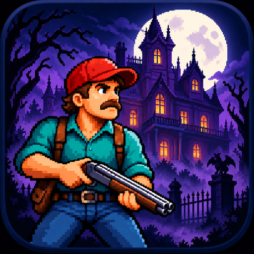
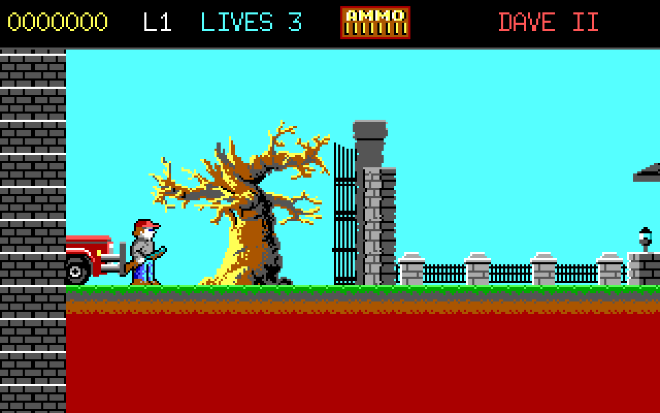
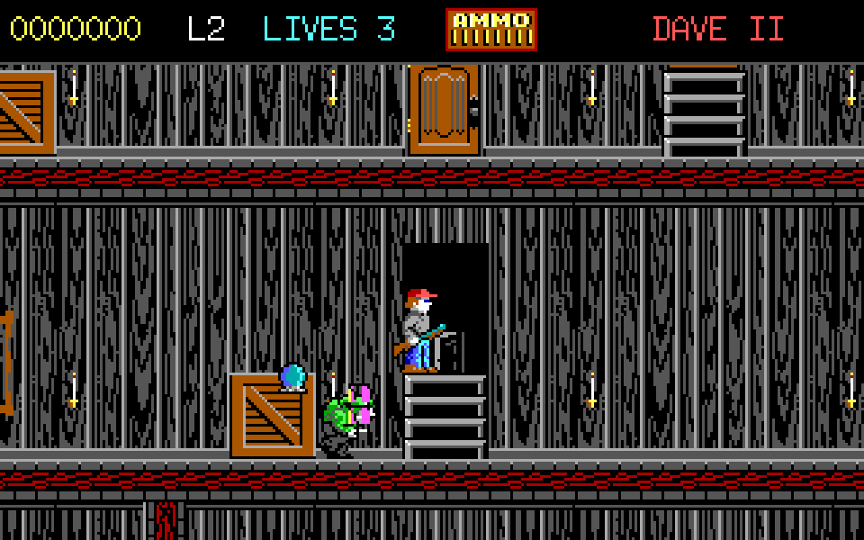
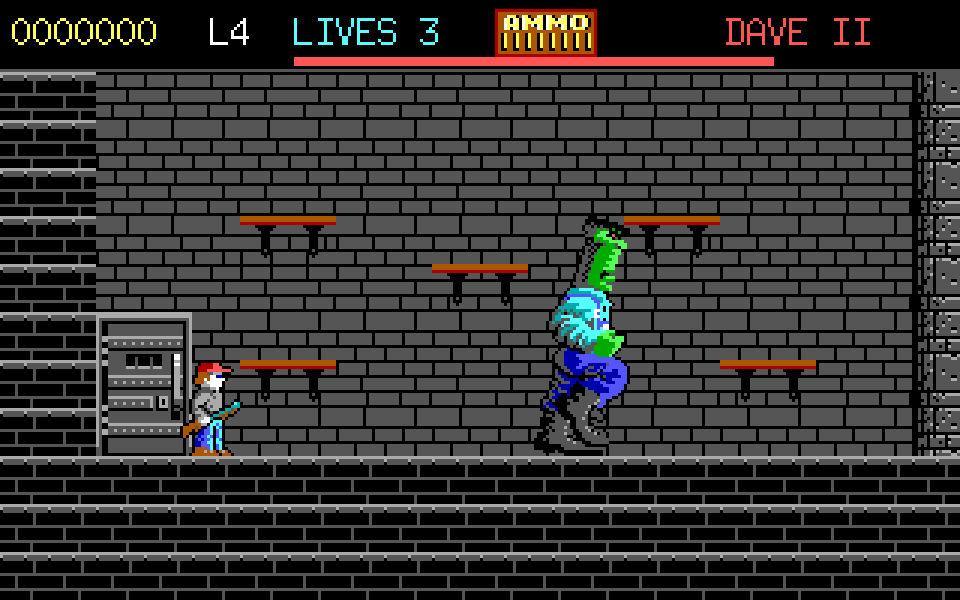

# Dangerous Dave in the Haunted Mansion

[English version](README.md)



Неофициальная реконструкция игры **Dangerous Dave in the Haunted Mansion** (Dangerous Dave II, 1991), написанная на Go. Исследуйте особняк, собирайте сокровища, уничтожайте монстров и боссов и спасите брата Дэйва — Дельберта.

Используются восемь оригинальных карт, графика EGA, спрайты персонажей, титульный экран, иллюстрированные анимации гибели и свойства столкновений тайлов, извлечённые из предоставленной DOS-версии. Движение, бой, поведение врагов, интерфейс, звуковые эффекты и сохранение реализованы на Go. MS-DOS и DOSBox для запуска не требуются: все необходимые игровые ресурсы встроены в исполняемый файл.

Это игровая реконструкция, а не восстановленные оригинальные исходники и не точный перенос инструкций DOS-программы. Физика, временные параметры врагов, поведение боссов, синтезированные звуки и интерфейс отличаются от оригинала.

## Возможности

- Восемь оригинальных уровней, включая две комнаты с боссами.
- Оригинальная 16-цветная графика EGA; логическое разрешение 320 × 200.
- Прокрутка карты, прыжки и платформы, через которые можно спрыгивать вниз.
- Стрельба из дробовика в восьми направлениях, магазин на восемь патронов, автоматическая перезарядка стоя.
- Зомби, ведьмы с ножами, призраки, слизни, пауки, огненные существа, волки, падающие ловушки, Фрэнк и хозяин особняка.
- Сокровища, дополнительные жизни, шкафы, выходы и связанные двери-телепорты.
- Оригинальные иллюстрированные сцены гибели.
- Пауза, справка по управлению, полный экран, отключение звука, ручное сохранение и загрузка.
- Новая иконка в форматах PNG, ICO и ICNS.
- Сборка для Windows, Linux и macOS на x64 и ARM64.

## Скриншоты

Снимки непосредственно из Go-версии, увеличенные в три раза без сглаживания.

### Перед особняком



### Внутри особняка



### Комната Фрэнка



## Как играть

Продвигайтесь по особняку, перепрыгивайте между этажами и стреляйте во врагов. Если стоять на поверхности и не стрелять, дробовик автоматически заряжается по одному патрону. Клавиша вверх открывает ближайший шкаф, активирует дверь-телепорт или выход. Каждый шкаф можно обыскать один раз за попытку прохождения уровня.

Обычные сокровища дают 100, 200, 400, 800 и 1 600 очков. Предмет 1UP добавляет жизнь; каждые 10 000 очков также дают дополнительную жизнь. В начале доступны три жизни. После гибели текущий уровень начинается заново; после потери всех жизней его можно повторить. Победа над Фрэнком переводит на пятый уровень, а победа над хозяином особняка завершает игру и освобождает Дельберта.

### Управление

| Действие | Клавиши |
| --- | --- |
| Движение | Стрелки влево / вправо или A / D |
| Прицеливание вверх / вниз | Стрелки вверх / вниз или W / S |
| Прицеливание по диагонали | Горизонтальное и вертикальное направления одновременно |
| Прыжок | Ctrl или пробел |
| Спрыгнуть сквозь платформу | Вниз + Ctrl / пробел |
| Выстрел | Alt или X |
| Открыть дверь / войти | Вверх, W или E |
| Начать новую игру / подтвердить | Enter |
| Продолжить сохранённую игру с титульного экрана | C |
| Пауза / продолжение | Esc или P |
| Справка | F1 |
| Включить / отключить звук | F2 |
| Сохранить | F5 |
| Загрузить | F9 |
| Полный экран | F11 |
| Начать текущий уровень заново | Пауза, затем R и Enter |
| Вернуться к титульному экрану | Пауза, затем M |
| Выход | Esc на титульном экране или закрытие окна |

Сохраняются позиция игрока, карта, враги, сокровища, двери, очки, жизни и патроны. Сохранение доступно во время игры, кроме анимаций гибели и перехода между уровнями. Предусмотрен один ручной слот.

Расположение файла по умолчанию:

- Windows: `%AppData%\DangerousDaveGo\save.json`
- Linux: `$XDG_CONFIG_HOME/DangerousDaveGo/save.json` либо `~/.config/DangerousDaveGo/save.json`
- macOS: `~/Library/Application Support/DangerousDaveGo/save.json`

## Требования

- **Go 1.25 или новее**.
- Доступ к интернету при первом скачивании зависимостей; версии закреплены в `go.mod` и `go.sum`.
- Графическая среда и работающий видеодрайвер.
- Ebitengine 2.10.5 использует чистый Go для этих настольных платформ: компилятор C, CGO, SDK SDL и кросс-компилятор не нужны.
- В Linux необходимы X11 либо XWayland и библиотеки выполнения OpenGL. Звук использует совместимый с PulseAudio сервис, включая соответствующий сервис PipeWire, с ALSA как запасным вариантом.

Для Debian / Ubuntu, если библиотеки ещё не установлены графической средой:

```sh
sudo apt install libx11-6 libgl1 libglx-mesa0 libxcursor1 libxi6 libxinerama1 libxrandr2 libxrender1 libxext6 libasound2t64
```

В Debian 12 / Ubuntu 22.04 используйте `libasound2` вместо `libasound2t64`. Если установлен и работает проприетарный видеодрайвер, сохраняйте его конфигурацию.

## Сборка и запуск

Команды выполняются из корня проекта — каталога с файлом `main.go`.

```sh
go mod download
go run .
```

Обычная сборка для текущей платформы встраивает игровые ресурсы и иконку окна:

```sh
go build -trimpath -o dangerous-dave .
```

В Windows укажите выходное имя `dangerous-dave.exe`. Одна команда `go build` сама по себе не добавляет ICO-ресурс в Windows EXE и не создаёт пакет приложения macOS. Для этих форматов используйте включённый в проект инструмент сборки.

### Windows — EXE с иконкой

```sh
go run ./tools/build -os windows -arch amd64
```

Результат: `dist/dangerous-dave-windows-amd64.exe`.

Для Windows на ARM:

```sh
go run ./tools/build -os windows -arch arm64
```

Инструмент читает `icon.ico`, создаёт временный `.syso`-ресурс для выбранной архитектуры, запускает `go build` с параметром `-H windowsgui` и удаляет временный ресурс после завершения. Внешний компилятор ресурсов или дополнительная утилита Go не нужны. Иконка встраивается в EXE и отображается в Проводнике.

### Linux

```sh
go run ./tools/build -os linux -arch amd64
```

Для ARM64:

```sh
go run ./tools/build -os linux -arch arm64
```

Результат: `dist/dangerous-dave-linux-amd64` либо `dist/dangerous-dave-linux-arm64`.

```sh
./dist/dangerous-dave-linux-amd64
```

Встроенный PNG используется как иконка окна. Иконки ярлыков в Linux задаются файлом desktop entry и отдельным изображением, а не Windows-ресурсом внутри исполняемого файла. Для ярлыка подходит `icon.png`.

### macOS — пакет приложения с иконкой

Apple Silicon:

```sh
go run ./tools/build -os darwin -arch arm64 -app
```

Intel:

```sh
go run ./tools/build -os darwin -arch amd64 -app
```

Результат: `dist/Dangerous Dave.app`. Инструмент копирует `icon.icns`, создаёт `Info.plist` и размещает исполняемый файл в `Contents/MacOS`. Откройте приложение через Finder либо выполните:

```sh
open "dist/Dangerous Dave.app"
```

Для обычного исполняемого файла macOS не указывайте `-app`:

```sh
go run ./tools/build -os darwin -arch arm64
```

### Кросс-компиляция

Все приведённые команды также работают с другой настольной платформы. Инструмент самостоятельно задаёт `GOOS`, `GOARCH` и `CGO_ENABLED=0`. Например, Linux ARM64 можно собрать в Windows или Linux x64 без компилятора C для ARM.

Для выбора выходного пути:

```sh
go run ./tools/build -os windows -arch amd64 -out dist/dave.exe
```

Сборка выполняется для одной выбранной архитектуры. Версии macOS для Intel и Apple Silicon собираются отдельно; параметр `-app` записывает пакет по одному и тому же пути, поэтому сохраните предыдущий результат перед второй сборкой. Подпись приложения и нотариализация являются отдельными этапами подготовки к распространению.

## Параметры командной строки

```sh
dangerous-dave --level 2 --fullscreen
dangerous-dave --mute --scale 4
dangerous-dave --save /path/to/save.json
```

| Параметр | Назначение |
| --- | --- |
| `--level 1..8` | Запустить выбранный уровень; по умолчанию показывается титульный экран |
| `--fullscreen` | Запуск на полном экране |
| `--scale 1..6` | Начальный масштаб окна; по умолчанию 3 |
| `--mute` | Отключить звук |
| `--save PATH` | Изменить расположение файла сохранения |
| `--version` | Вывести версию |
| `--capture PATH` | Сохранить игровой кадр в PNG и завершить работу |
| `--ticks N` | Число кадров до снимка; по умолчанию 1 |
| `--demo` | Автоматическое движение для создания скриншотов |

Пример создания снимка; требуется работающая графическая среда:

```sh
go run . --mute --level 1 --ticks 120 --capture entrance.png
```

## Структура проекта

```text
main.go                 Окно, ввод, параметры командной строки
render.go               Отрисовка, меню, интерфейс, создание скриншотов
audio.go                Синтезированные звуковые эффекты
internal/game/          Движок, столкновения, бой, сохранение, регрессионные тесты
assets/                 Встроенная графика PNG, карты, спрайты, свойства тайлов
tools/build/            Сборка для разных платформ и создание ресурса иконки
screenshots/            Скриншоты для README
licenses/               Уведомление о правах на оригинальные ресурсы и лицензии зависимостей
icon.png / .ico / .icns  Иконка приложения
LICENSE                 Лицензия нового кода Go
README.md / README.ru.md Английская / русская документация
RELEASE.md              Готовое описание релиза GitHub на английском
```

Архив содержит исходный проект и необходимые ресурсы. Старая DOS-программа, готовые сборки игры, эмулятор и каталог vendor в него не включены.

## Проверки

```sh
go test ./...
go vet ./...
```

Тесты движка проверяют загрузку карт и безопасные начальные позиции, прыжки и приземление, столкновения со стенами, спрыгивание сквозь платформы, попадания и перезарядку, телепорты, однократное получение бонусов из шкафов, дополнительные жизни, сохранение/загрузку и завершение боя с последним боссом.

При подготовке проект запускался в Linux x64, и были отрисованы все восемь уровней. Проверена сборка для Windows, Linux и macOS на x64 и ARM64. В Windows EXE проверены каталоги ресурсов и встроенная иконка. Файлы Windows и macOS получены кросс-компиляцией; запуск непосредственно в этих системах не проверялся. Автоматический поиск по геометрии проверил доступ к выходам и позициям для стрельбы по боссам; полное ручное прохождение не выполнялось.

## Лицензии и авторство

- Новый код Go: [лицензия MIT](LICENSE).
- Графика, карты, иллюстрированные сцены и остальные извлечённые данные оригинала: [уведомление о правах на ресурсы](licenses/ORIGINAL-ASSETS.md). **Лицензия MIT проекта на них не распространяется.** Предоставленный архив подтверждает происхождение ресурсов, но не разрешение на их публичное распространение.
- Новая иконка и синтезированные звуки: см. [уведомление о правах на ресурсы](licenses/ORIGINAL-ASSETS.md).
- Ebitengine и прочие зависимости: соответствующие лицензии в каталоге [licenses/](licenses/).

Оригинальная игра: id Software / Softdisk, 1991. Название Dangerous Dave, оригинальные персонажи и графика принадлежат соответствующим правообладателям. Этот проект неофициальный и не одобрен ими.

Благодарности за исследование форматов:

- [Описание обратного проектирования Dangerous Dave — Gil Megidish](https://github.com/gmegidish/dangerous-dave-re).
- [ModdingWiki: Dangerous Dave 2](https://moddingwiki.shikadi.net/wiki/Dangerous_Dave_2), включая исследования Andrew Durdin, Levellass и сообщества моддинга Keen.
- [Документация Ebitengine по настольным платформам](https://ebitengine.org/en/documents/install.html).
